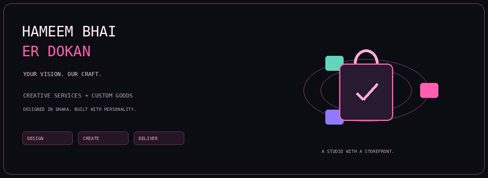

<div align="center">



# Hameem Bhai er Dokan

### Your vision. Our craft.

A creative-studio storefront from Dhaka, bringing custom goods, design services,
and a personal brand into one multi-page shopping experience.

`HTML` · `CSS` · `Vanilla JavaScript` · `Node.js` · `Express`

[The experience](#a-studio-with-a-storefront) · [Features](#what-is-inside) · [Local setup](#local-development) · [Architecture](#how-it-fits-together) · [Safety](#important-security-status)

</div>

---

## A studio with a storefront

Not every shop starts with a warehouse. Sometimes it starts with a sketch, an
idea, and someone who wants to make it real.

Hameem Bhai er Dokan brings creative work and custom products under one roof:
graphic design, posters, websites, digital paintings, and custom lighter cases.
The site connects that catalogue to a cart, wishlist, account pages, checkout,
order history, and an administrative workspace.

This is the source repository for the project—not a guarantee of production
security or verified payment processing. The banner is illustrative artwork,
not a recording of the website.

## What is inside

| Area | Capabilities visible in the source |
| :--- | :--- |
| Discovery | Service categories, individual service pages, recommendations, and reviews. |
| Shopping | Cart quantities, saved wishlist, promo codes, and returning-customer discount logic. |
| Accounts | Registration, login, logout, profile editing, and session-token handling. |
| Orders | Authenticated order submission, customer history, and admin status updates. |
| Administration | Service edits, review management, recommendations, blog content, and referral codes. |
| Brand | About, contact, policy pages, brand guidelines, posters, and business-card assets. |
| Frontend state | Browser localStorage and an event bus shared by UI components. |
| Backend | Express API with a JSON-file persistence prototype. |

The catalogue uses five categories: Lighter Cases, Graphics Design, Poster Design,
Website Building, and Digital Painting. Source text describes bKash and cash-on-
delivery instructions; those should not be described as a verified payment gateway
without a server-side payment integration and confirmation flow.

## Local development

Use a supported Node.js release compatible with the locked dependency versions.
The server uses global `fetch` for its optional GitHub publishing path.

```bash
git clone https://github.com/Hameem-Bhai/Hameem_e-commerce_website.git
cd Hameem_e-commerce_website
npm ci
```

If `npm ci` reports a manifest/lockfile mismatch, inspect it instead of silently
replacing the lockfile. Resolve dependency changes deliberately.

Before starting, review `db.json` locally and replace any personal records with
synthetic fixtures. Do not publish its contents or paste them into an issue.

Optional local environment:

```dotenv
PORT=3000
```

Leave `GITHUB_TOKEN` and `GITHUB_REPO` unset for the local demonstration. The
current code catches unconfigured publish attempts and logs them; it does not
need GitHub write credentials to start its local API.

```bash
npm start
```

Open http://localhost:3000 in a browser. Keep the server terminal open and avoid
exposing this development instance to the public internet or an untrusted network.

Use the server, not a `file://` page: account and order functionality calls `/api`.
The homepage also loads remote fonts and an EmailJS browser script, so this is not
an unconditional offline-only experience.

## Try the experience

1. Browse the service categories and open a detail page.
2. Save an item to the wishlist.
3. Add a service to the cart and change its quantity.
4. Inspect promo-code and delivery-fee calculations.
5. In a safe local copy, use a disposable account to inspect profile and order flows.
6. Review admin operations only after fixing the account/admin security model.

Do not send real payments or use a personal password to test the checkout.

## How it fits together

```text
HTML pages + CSS + page-specific JavaScript
                   |
                   v
window.HBD modules
  data / components / store / content / utilities
                   |
        localStorage + EventBus
                   |
                   v
Same-origin /api requests
                   |
                   v
Express server.js
                   |
                   v
Local db.json (prototype persistence)
```

The frontend keeps cart and wishlist state in the browser. Account and order
operations call the API. Browser state and client-submitted totals are not a
security boundary; the server should independently authorize and validate requests.

<details>
<summary>Explore the project structure</summary>

```text
Hameem_e-commerce_website/
├── index.html
├── services.html / service.html
├── cart.html / checkout.html / wishlist.html
├── login.html / register.html / profile.html / orders.html
├── admin.html
├── about.html / contact.html / blog.html
├── css/
├── js/
│   ├── data.js
│   ├── store.js
│   ├── components.js
│   └── pages/
├── server.js
├── db.json
├── package.json
├── package-lock.json
├── .env.example
├── vercel.json
├── docs/assets/dokan-studio.gif       # Added by this README pack
└── ... brand assets and helper scripts
```

The repository currently has many root-level images, helper scripts, and exported
brand files. See the cleanup guide in this pack for a suggested organization.
The diagram describes the current layout; it does not imply that files were moved.

</details>

<details>
<summary>Representative API routes</summary>

| Method | Route | Purpose |
| :--- | :--- | :--- |
| GET | `/api/public-data` | Public catalogue and display data. |
| POST | `/api/auth/register` | Create an account. |
| POST | `/api/auth/login` | Create a session. |
| POST | `/api/auth/logout` | Clear the stored session token. |
| GET | `/api/auth/me` | Read the authenticated profile. |
| PUT | `/api/auth/profile` | Update profile fields. |
| GET | `/api/services` | List services. |
| GET / POST | `/api/reviews` | Read or submit reviews. |
| POST | `/api/orders` | Submit an authenticated order. |
| GET | `/api/orders/my` | Read customer orders. |
| GET | `/api/orders` | Admin order listing. |
| PUT | `/api/orders/:id` | Admin order status update. |
| GET | `/api/referrals` | Read referral definitions. |
| GET / POST | `/api/admin/db/export`, `/api/admin/db/import` | Administrative database operations. |

The client sends a raw token in `Authorization`; the current middleware also
accepts `x-auth-token`. It does not strip a standard `Bearer ` prefix.
Some admin save functions in the frontend are placeholders. A visible control or
success message alone does not establish durable server-side behavior.

</details>

<details>
<summary>Deployment considerations</summary>

`vercel.json` rewrites `/api/*` to `https://hameembhaierdokan.studio/api/*`. This
routes requests to another host; it does not provision an Express backend or a
persistent database. The destination's availability and configuration were not
verified for this documentation.

GitHub Pages alone cannot execute this Node/Express API. A static frontend host
needs a separately deployed backend, correct routing, and safe persistent storage.
Do not rely on commits of runtime customer data as a database backup strategy.

Before deployment:

1. Serve an explicit public directory, not the repository root.
2. Move private data outside the static directory and into a proper database.
3. Hash passwords and use verified identities, secure sessions, and explicit roles.
4. Validate catalogue prices, order totals, discounts, stock, and ownership server-side.
5. Remove secret-bearing database publication and sanitize stored fixtures.
6. Add error handling, input validation, rate limits, and deployment-specific CORS.

</details>

<details>
<summary>Tests, limitations, and useful next work</summary>

The repository contains scripts including `test.js`, `full_test.js`, and targeted
admin/persistence tests. `package.json` currently defines `start` but no `test`
script. Inspect test code and endpoints before execution: tests may change records.
No passing suite, coverage figure, load benchmark, or production-security claim is
made here.

Important implementation details to test:

- The JSON write queue serializes file writes, but not an entire concurrent
  read-modify-write transaction. Updates can still overwrite each other.
- Write errors are logged and swallowed, which can let a request appear successful
  even if persistence failed.
- Cart merging currently matches service IDs without checking tiers.
- Admin-only identity must not be obtainable by registering a matching email.
- `/api/users` must never return password data.
- Static requests to private files must be rejected.
- Order totals must be calculated from trusted catalogue records.

For visual polish, add real desktop/mobile screenshots after removing any
customer details, tokens, and payment information. Consider reduced-motion
preferences, keyboard navigation, contrast, image size, and form accessibility.

</details>

## Contributing

Prefer small, focused changes with reproduction steps and tests. Do not include
real account records, customer data, payment details, tokens, or local `.env` files.
Use synthetic fixtures for screenshots, issues, and pull requests.

## License

No top-level LICENSE was visible in the reviewed listing. The author should choose
an explicit license before advertising reuse rights. This README does not grant a
license to the application, product artwork, or brand assets.

---

<div align="center">

Built by [Hameem](https://github.com/Hameem-Bhai) in Dhaka.

**A studio with a storefront. A builder behind every detail.**

</div>
